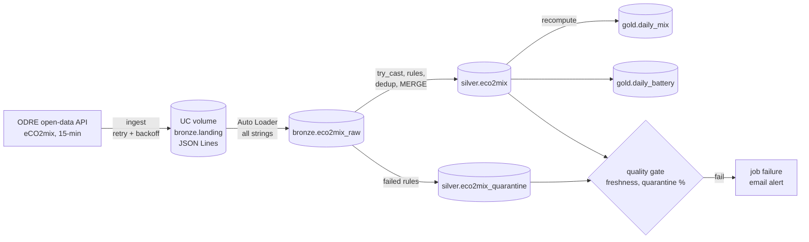

# Energy Lakehouse

A **medallion lakehouse on Databricks**, fed by real open data: the French national electricity mix (RTE eCO2mix, published every 15 minutes).

It is built the way production data platforms are:
- **Unity Catalog** managed with **Terraform**;
- pipelines packaged as a **Python wheel**, deployed with **Databricks Asset Bundles**;
- **unit tests on local Spark**;
- **GitHub Actions** promoting dev → staging → prod through **OIDC workload identity federation**, with no stored Databricks secret.

## Architecture



One serverless Databricks job runs every 30 minutes: `ingest → bronze → silver → gold → quality_gate`.

| Layer | What happens | Why |
|---|---|---|
| **Landing** | Each run writes the raw API response untouched, as JSON Lines, to a Unity Catalog volume. The last 2 days are re-fetched every time. | The source is always replayable, and late corrections from RTE get picked up. |
| **Bronze** | Auto Loader loads new files incrementally. Every column stays a **string**, and lineage columns are added (`_ingested_at`, `_source_file`). | The real API sends some numbers as JSON strings. Bronze must never drop or reject a record. |
| **Silver** | Each column is typed with `try_cast`. Unparsable values are listed in `_parse_errors`. Five quality rules are checked, failing rows go to quarantine with the names of the failed rules, and rows are deduplicated per interval before a Delta `MERGE` (newest ingestion wins). Uses liquid clustering. | Spark 4 runs in ANSI mode, so one bad value would otherwise fail the whole batch. |
| **Gold** | Daily aggregates in **Europe/Paris** local days, which handles 92/96/100-interval DST days: energy per source, low-carbon share, net exports, carbon intensity, and grid battery charge/discharge. | Gold is small, so it is fully recomputed, which keeps it idempotent. |
| **Quality gate** | The run fails if the newest interval is more than 3 h old, or if more than 5% of rows were quarantined in the last 24 h. | SLO-style alerting: a broken feed fails the run, a single bad record does not. |

## What this project demonstrates

- **Data engineering on Databricks**: Auto Loader, Structured Streaming `availableNow`, `foreachBatch` + Delta `MERGE`, Unity Catalog volumes, liquid clustering, serverless jobs.
- **Data quality as code**: declarative rules, a quarantine table that says why each row failed, and a quality gate wired to alerting.
- **Testing**: 23 pytest tests run against a real local SparkSession, using a fixture captured from the live API. They cover timezone and DST boundaries, string-encoded numbers, deduplication and API retries.
- **Infrastructure as Code**: Terraform defines a Unity Catalog catalog per environment, the medallion schemas, the volumes and authoritative grants (least privilege: analysts only read prod gold).
- **CI/CD**:
  - every PR runs lint, tests and the wheel build;
  - `main` deploys to **staging** and **runs the full pipeline on real data** as an integration test;
  - a GitHub **release** deploys to **prod** after manual approval.
- **Security**: GitHub OIDC is federated to a Databricks service principal, so there is no PAT or client secret anywhere. Staging and prod run as that service principal, never as a person.

## Repository layout

```text
.
├── databricks.yml              # bundle: artifacts, variables, dev/staging/prod targets
├── resources/eco2mix_job.yml   # serverless job, schedule, retries, alerts, health rule
├── src/energy_lakehouse/
│   ├── ingest.py               # API -> volume (retry/backoff)
│   ├── bronze.py               # Auto Loader
│   ├── silver.py               # typing, quality rules, quarantine, dedup, MERGE
│   ├── gold.py                 # daily mix + battery aggregates
│   ├── quality.py              # freshness / quarantine-ratio gate
│   ├── schema.py               # source -> silver column mapping
│   └── cli.py                  # `lakehouse <step> --catalog <catalog>` entry point
├── tests/                      # pytest + local Spark, real-data fixture
├── terraform/                  # Unity Catalog: catalogs, schemas, volumes, grants
├── sql/gold_queries.sql        # analysis queries for SQL editor / dashboards
└── .github/workflows/          # ci.yml, deploy.yml, terraform.yml
```

## Run the tests locally

Requires Java 17 and [uv](https://docs.astral.sh/uv/):

```bash
uv sync
uv run pytest
```

## Deploy

**One-time setup**

1. Create a service principal (`energy-lakehouse-deployer`) in the Databricks account and add it to the workspace.
2. Add a **federation policy** to that service principal so it trusts GitHub's OIDC issuer (`https://token.actions.githubusercontent.com`), with subjects `repo:<owner>/<repo>:environment:staging`, `…:environment:prod` and `…:environment:platform`. See the Databricks docs on *workload identity federation for GitHub Actions*.
3. In GitHub, create the environments `staging`, `prod` (required reviewers, tag-only) and `platform`. Set the variables `DATABRICKS_HOST`, `DATABRICKS_CLIENT_ID` and `DEPLOYER_APPLICATION_ID`.
4. Create an HCP Terraform workspace `energy-lakehouse-unity-catalog` in *local* execution mode. Set `TF_CLOUD_ORGANIZATION` as a variable and `TF_API_TOKEN` as a secret.

**Unity Catalog**: merge a change under `terraform/`. The PR shows the plan, and `main` applies it after approval.

**Pipelines**

Locally, deploy your own dev copy (the schedule is paused, and resources are prefixed with your name):

```bash
databricks auth login --host https://<workspace>.cloud.databricks.com
databricks bundle deploy -t dev
databricks bundle run eco2mix_pipeline -t dev
```

Merge to `main` to deploy to staging and run the integration test. Publish a GitHub release to deploy to prod.

## Data source & license

eCO2mix data © RTE, distributed by ODRE (opendata.reseaux-energies.fr) under the Licence Ouverte / Etalab 2.0. The test fixture is one day of that data. The code is MIT-licensed.

## Status and roadmap

The Spark transformations and the Terraform are tested locally (`pytest`, `terraform validate`). The bundle and workflows follow the Databricks CLI v1 conventions but have **not been run against a live workspace yet**: run `databricks bundle validate` first.

Next steps:
- Lakeflow Declarative Pipelines version of silver, using native expectations, for comparison
- Per-developer schemas in the dev catalog, so dev runs never collide
- AI/BI dashboard on the gold tables, deployed as a bundle resource
- Historical backfill from the consolidated dataset (`eco2mix-national-cons-def`)
